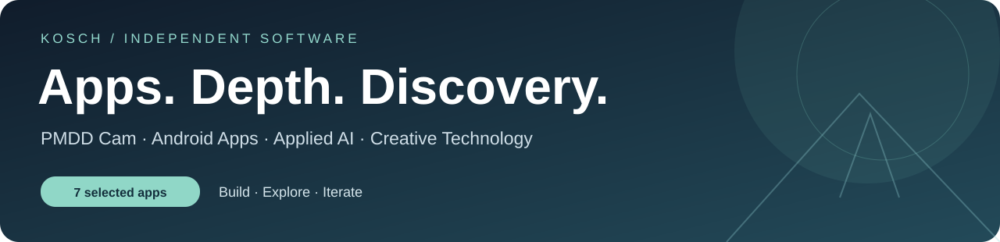
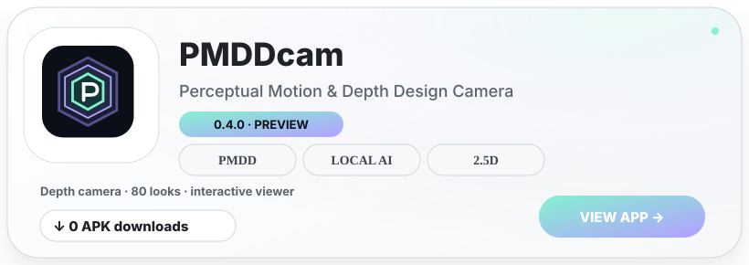

# KoSch · Apps mit eigener Perspektive

**Fotografie. Entdeckungen. Wissen. Spielwelten.** 
Android-Apps und kreative Technologie von Kolja W. Schumann.

[**App Store öffnen →**](https://raw.githack.com/chekento/chekento/main/docs/store.html) · [kosch.cloud](https://kosch.cloud)

## 📷 Im Mittelpunkt: PMDD Cam

**Bilder mit räumlicher Wirkung gestalten.** PMDDcam verbindet Kamera, Bildgestaltung und Perceptual Motion & Depth Design. Eine eigene Perspektive auf computational photography – mit kreativen Stilen und lokalem Bildworkflow.

[**PMDD Cam entdecken & herunterladen →**](https://github.com/chekento/PMDDcam/releases)

## ★ Meine App-Auswahl

Die von mir mit einem GitHub-Stern ausgewählten Projekte. PMDD Cam steht im Fokus; danach folgen die Apps nach tatsächlichen APK-Downloads. Verfügbare Vorabversionen sind entsprechend gekennzeichnet.

<!-- APP-CATALOG:START -->
**7 ausgewählte Apps · 45 APK-Downloads**

| App | Entdecken | Android-Download | APK-Downloads |
|---|---|---|---:|
| **[PMDDcam](https://github.com/chekento/PMDDcam)** | Fotografie mit Wahrnehmungstiefe und kreativen Bildstilen | [↓ v0.4.0 · Preview](https://github.com/chekento/PMDDcam/releases/download/v0.4.0/PMDDcam-0.4.0.apk) |  |
| **[Scenic Path](https://github.com/chekento/scenic-path-android)** | Schöne Wege, Sehenswürdigkeiten und neue Perspektiven | [↓ v0.7.3-rc4 · Preview](https://github.com/chekento/scenic-path-android/releases/download/v0.7.3-rc4/Scenic-Path-v0.7.3-rc4-debug.apk) |  |
| **[AI News](https://github.com/chekento/Ainews)** | KI-Nachrichten, Quellen und persönliches Themenradar | [↓ android-latest](https://github.com/chekento/Ainews/releases/download/android-latest/AI-News.apk) |  |
| **[AIevents](https://github.com/chekento/AIevents-)** | KI-Konferenzen, Meetups und Workshops weltweit | [↓ v0.5.3](https://github.com/chekento/AIevents-/releases/download/v0.5.3/AIevents-latest.apk) |  |
| **[Chroma Clash](https://github.com/chekento/chroma-clash-android)** | Farbgefühl und Wahrnehmung spielerisch trainieren | [↓ v1.0.0 · Preview](https://github.com/chekento/chroma-clash-android/releases/download/v1.0.0/Chroma-Clash-1.0.0.apk) |  |
| **[PizzaScan](https://github.com/chekento/Pizzascan)** | Pizza und italienische Küche auf der Karte entdecken | [↓ v2.3.23 · Preview](https://github.com/chekento/Pizzascan/releases/download/v2.3.23/PizzaScan-2.3.23.apk) |  |
| **[Labyrinthia](https://github.com/chekento/labyrinthia-endless-maze)** | Prozedurale Labyrinthe und Bewegungssteuerung | [↓ v2.4.3 · Preview](https://github.com/chekento/labyrinthia-endless-maze/releases/download/v2.4.3/Labyrinthia-v2.4.3-debug.apk) |  |
<!-- APP-CATALOG:END -->

## ❄️ Neu veröffentlicht: SkiZones 0.42.0

**Dein Berg. Dein Resort. Dein nächster Winter.** Pisten bauen, Lifte betreiben und eine lebendige Alpenwelt mit Gästen, Personal und Wirtschaft entwickeln.

<!-- SKIZONES-DOWNLOAD:START -->

[v0.42.0 · Android Preview](https://github.com/chekento/SkiZones/releases/tag/v0.42.0) · [Game & documentation](https://github.com/chekento/SkiZones) · 
<!-- SKIZONES-DOWNLOAD:END -->

Die 0.42 bringt unter anderem den Pisteneditor mit Rückgängig/Wiederholen, zwanzig Snowpark-Module, überarbeitete Gebäude in zehn Grafikstilen, NPC-Schneekontakt, Pistenrettung, frühe Ziele und die Mitarbeiterakademie.

[**Changelog**](https://github.com/chekento/SkiZones/blob/main/CHANGELOG.md) · [**Spiel & Screenshots**](https://github.com/chekento/SkiZones)

## Hinter den Apps

Ich bin Kolja Werner Schumann, **KoSch**: Digital Workplace Specialist, Fachinformatiker für Systemintegration und Manager für angewandte KI-Transformation. Meine Projekte verbinden Softwareentwicklung, angewandte KI, Gestaltung und interaktive Systeme.

Die Downloadzahlen zählen APK-Dateien aus öffentlichen GitHub-Releases, keine eindeutigen Nutzer oder Installationen. Der App-Katalog folgt meiner Stern-Auswahl; SkiZones ist hier zusätzlich als aktuelle Veröffentlichung verlinkt. Neue Downloads und Zahlen werden automatisch aktualisiert.
